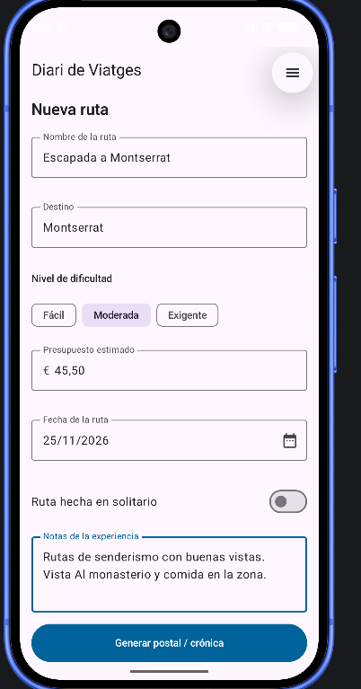
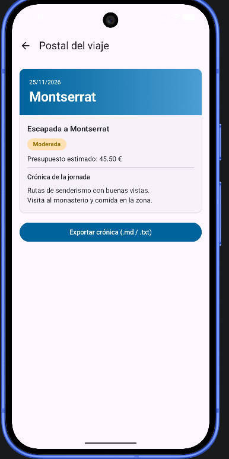
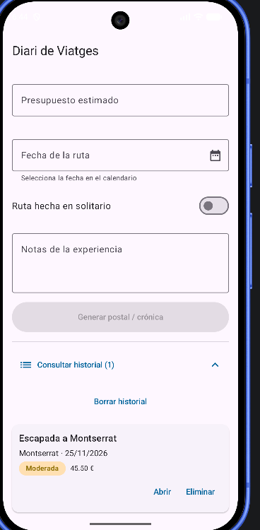

# Diari de Viatges / Crónica de Ruta

Aplicación Android desarrollada con **Jetpack Compose** y arquitectura **MVVM** para registrar rutas o escapadas, generar una postal visual con la crónica del viaje y gestionar la persistencia interna y externa.

## Arquitectura (MVVM)

```text
model/       RouteEntry
             TravelDiaryUiState

viewmodel/   TravelDiaryViewModel

data/        DiaryRepository

navigation/  NavGraph

ui/          FormScreen
             PostalScreen
             DifficultyBadge
             Theme

util/        ChronicleFormatter
```

### Model

`RouteEntry` es una `data class` inmutable y serializable que representa una ruta.

Contiene los datos principales de la ruta, como el nombre, destino, dificultad, presupuesto, fecha, si se ha realizado en solitario y las notas.

`TravelDiaryUiState` contiene el estado de la interfaz, incluyendo los datos introducidos en el formulario, los errores de validación y el histórico de rutas guardadas.

### ViewModel

`TravelDiaryViewModel` gestiona el estado de la aplicación.

Utiliza un `MutableStateFlow` privado y expone un `StateFlow` público mediante `asStateFlow()`.

Los cambios de estado se realizan de forma inmutable utilizando `.copy()`.

También contiene la lógica de validación del formulario y los métodos necesarios para generar, eliminar y consultar las rutas.

### View

La interfaz está desarrollada con Jetpack Compose.

Las principales pantallas son:

- `FormScreen`: formulario para introducir una nueva ruta.
- `PostalScreen`: muestra la información de la ruta en formato de postal.
- Histórico desplegable para consultar las rutas guardadas.

## Funcionalidades

1. **FormScreen**
   - Nombre de la ruta y destino con validación en tiempo real.
   - Selección de dificultad mediante `FilterChip`.
   - Presupuesto numérico utilizando `KeyboardType.Decimal`.
   - Selección de fecha mediante `DatePickerDialog`.
   - `Switch` para indicar si la ruta se ha realizado en solitario.
   - Campo de notas multilínea.
   - Botón **Generar postal / crónica**, deshabilitado mientras el formulario no sea válido.

2. **PostalScreen**
   - Muestra la fecha y el destino.
   - Muestra el nombre de la ruta.
   - Insignia con el nivel de dificultad.
   - Presupuesto estimado.
   - Crónica de la jornada.
   - Botón **Exportar crónica (.md / .txt)** mediante `ActivityResultContracts.CreateDocument("text/plain")`.

3. **Histórico**
   - Permite consultar las rutas guardadas.
   - Permite volver a abrir una ruta.
   - Permite eliminar una ruta concreta.
   - Permite borrar todo el historial.

4. **Persistencia interna**
   - Cada ruta generada se guarda automáticamente en `filesDir/diari_viatges.json`.
   - Al volver a abrir la aplicación, el ViewModel carga el histórico guardado.

5. **Exportación**
   - La crónica puede exportarse mediante Storage Access Framework.
   - El usuario puede seleccionar dónde guardar el archivo.

## Capturas de la aplicación

### Formulario



### Postal



### Histórico



## Almacenamiento interno y externo

### Almacenamiento interno

Para guardar el histórico de rutas utilizamos `context.filesDir`.

Las rutas se almacenan en el archivo:

```text
diari_viatges.json
```

Los datos se guardan en formato JSON utilizando serialización.

Este almacenamiento es privado de la aplicación y el usuario no accede directamente al archivo.

Si se desinstala la aplicación, los datos almacenados en `filesDir` se eliminan.

### Almacenamiento externo

Para exportar una crónica utilizamos:

```kotlin
ActivityResultContracts.CreateDocument("text/plain")
```

Este sistema abre el selector de archivos de Android y permite al usuario decidir dónde guardar el archivo exportado.

El archivo se puede guardar, por ejemplo, en Documents o Descargas.

A diferencia del almacenamiento interno, el archivo exportado pertenece al usuario y puede continuar existiendo aunque se desinstale la aplicación.

## Conceptos aprendidos

### FilterChip

`FilterChip` permite seleccionar una opción entre diferentes posibilidades.

En este proyecto se utiliza para elegir entre las dificultades:

- Fácil
- Moderada
- Exigente

### DatePickerDialog

`DatePickerDialog` permite mostrar un calendario para seleccionar la fecha de la ruta.

### MutableStateFlow y StateFlow

`MutableStateFlow` permite al ViewModel modificar el estado de la aplicación.

`StateFlow` permite que la interfaz pueda observar ese estado sin modificarlo directamente.

### asStateFlow()

`asStateFlow()` permite convertir el `MutableStateFlow` privado en un `StateFlow` público de solo lectura.

### .copy()

El método `.copy()` permite crear una nueva versión de una `data class` modificando solamente las propiedades necesarias.

Esto permite trabajar con estados inmutables.

### Serialización JSON

Se utiliza `kotlinx.serialization` para convertir las rutas a formato JSON y guardarlas en el almacenamiento interno.

Cuando se vuelve a abrir la aplicación, el archivo JSON se lee para recuperar el histórico.

### CreateDocument

`ActivityResultContracts.CreateDocument` permite abrir el selector de archivos de Android para que el usuario pueda guardar la crónica exportada.

### collectAsStateWithLifecycle()

`collectAsStateWithLifecycle()` permite observar el `StateFlow` desde una pantalla Compose respetando el ciclo de vida de la aplicación.

## Cómo abrir el proyecto

1. Abrir la carpeta raíz del proyecto en **Android Studio**.
2. Esperar a que Gradle termine de sincronizar.
3. Seleccionar la configuración `app`.
4. Ejecutar el proyecto en un emulador o dispositivo con API 24 o superior.